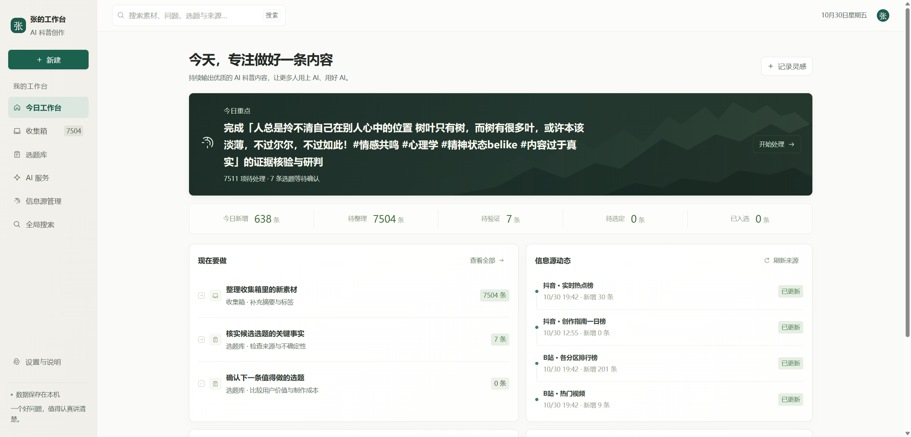

# 张的工作台

面向AI科普创作者的本地选题工作台：多平台收集素材、自动初筛、整理证据，再人工确定值得创作的选题。



**首个发布版本：v0.1.0 · 2026-10-27**。React + Vite前端、Node.js HTTP服务和SQLite数据库。命令行默认仅本机访问，Windows启动脚本启用局域网模式。

## 快速启动

需要Node.js 24（内置`node:sqlite`）和npm。

```sh
npm ci
npm run build
npm start
```

浏览器打开 **http://127.0.0.1:4173**。Windows可双击`启动工作台.cmd`；首次使用安装依赖并构建，保持命令窗口运行。

启动脚本默认开启局域网访问，窗口会打印本机和局域网URL。同一网络的手机/电脑打开`http://本机局域网IP:4173`。若Windows防火墙询问，允许Node.js通过专用网络；不自动修改防火墙规则。命令行可设置`STUDIO_LAN=1`后运行`npm start`，仅本机模式则不设置此变量。

局域网模式共享同一份本机数据库，尚无账号隔离，仅用于可信局域网。服务保留Host白名单、同源校验及客户端私网地址检查，不应配置公网端口转发。网络地址变更后重启服务。

升级源码后重新执行`npm ci`、`npm run build`，关闭原服务再运行`npm start`。仅刷新页面不会更新后端。启动脚本只在缺少构建文件时构建，升级需主动重新构建。

## 核心功能

- 收集箱：平台、来源、行业/分区与内容形式联动筛选，标签去重、分页及条件清除。正文16px，辅助说明至少14px。
- 时间：优先发布时间，缺失或无效时按入库时间并标注；最新发布排序采用相同规则。
- 自动初筛：AI科普优先分、可解释依据、估计项和数据充分度。
- 选题研判：目标问题、角度、关联证据、人工评分、核验、状态与决策历史；一条素材支持多个选题。
- 来源管理：独立启停、采集间隔、日志及重试，按钮只采集所选平台/来源。
- 本地数据：SQLite、URL/内容ID去重、指标快照、JSON备份恢复、搜索与CSV导出。
- 可选本地模型：llama.cpp兼容接口，提供摘要、角度和研判建议，不代替人工决定。

## 来源与覆盖范围

| 来源 | 支持范围 | 说明 |
|---|---|---|
| 抖音 | 实时热点、一日榜24个行业 | 保留统计日期，累计指标不当作日增量 |
| B站 | 综合热门、14个UGC分区排行榜 | 动态读取分区；近期综合榜非一日新增榜，不混入番剧/电影等PGC |
| 小红书 | 公开热点、第三方每日话题快照、360公开索引笔记线索、JSON导入 | 笔记索引按12个关键词取前2页，可编辑检索词；标题/摘要不是全文，搜索顺序不是热度，搜索页日期不充当发布日期；尚未稳定接入公开多行业笔记榜 |
| RSS/Atom | Hugging Face博客、量子位及自定义源 | AIHOT精选可添加`https://aihot.news/feed.xml` |
| GitHub/Hugging Face | 仓库搜索、模型元信息 | stars、下载量是累计快照，非视频流量或增长 |
| RSSHub | 七家AI厂商订阅 | 区分官网新闻与开源仓库动态 |

各行业素材完整入库，AI优先分只用于筛选排序。外部来源可能缓存、限流、变更或停用，失败不清空旧素材。

### RSSHub

默认实例`https://rsshub.bestblogs.dev`，可在设置中统一更换公开HTTP(S)实例，保留路由和历史。采集器不访问本机或内网实例。

| 厂商 | 路由 | 内容 |
|---|---|---|
| Anthropic | `/anthropic/news` | 官网新闻 |
| OpenAI | `/openai/news` | 官网新闻 |
| DeepSeek | `/deepseek/news` | 官网新闻 |
| 豆包 | `/github/repos/ByteDance-Seed/all/updated` | Seed官方开源项目，非豆包App公告 |
| Kimi | `/github/repos/MoonshotAI/all/updated` | 官方开源项目，非产品公告 |
| xAI | `/github/repos/xai-org/all/updated` | 官方开源项目，非官网新闻 |
| Meta | `/meta/ai/blog` | AI官方博客 |

仓库更新时间单列，不冒充产品发布日期；同仓库按URL去重，后续数据保留快照。

## 评分与工作流

自动初筛默认：**AI方向匹配35%、实用内容线索25%、平台关注度15%、内容时效15%、资料完整度10%**。每项0–5分，加权为百分制。75分以上优先查看，55分以上值得查看，分数不是爆款概率。

缺少可比热度或可信发布时间时，使用明确标注的中性估计2.5/5并降低数据充分度；充分度不是准确率。未识别明确AI主题的素材限制总分：无匹配最高25分，仅定位词匹配最高50分。时间筛选允许入库时间回退，时效评分仍区分真实发布时间与未知时间。

推荐流程：**采集 → 查看高分素材 → 整理 → 创建待验证候选 → 关联核实证据 → 人工确认入选**。

旧六维保留为独立人工深度研判，历史不被自动初筛改写；人工评分优先于AI和旧规则建议。入选由用户决定，不再要求旧六维评分完整；来源核验独立提醒，发布前需检查关键事实。归档不会删除历史。

## 定时与本地数据

一般来源默认每4小时，抖音一日榜、小红书每日快照默认每天；来源可单独调整，最小30分钟。服务每分钟检查到期来源，启动时补扫，关闭服务期间不执行，无需浏览器常开。

来源并发2，同源并发合并；成功手动请求冷却1分钟。一般公开请求16秒超时、上限4MB；平台多分区请求另有间隔。

| 路径 | 内容 | Git |
|---|---|---|
| `data/studio.sqlite`及WAL文件 | 实际数据库 | 排除 |
| `data/backups/` | 自动、手动、恢复前备份 | 排除 |
| `work/` | 临时文件与隔离测试库 | 排除 |
| `dist/` | 可重建的构建产物 | 排除 |
| `outputs/` | 本地截图、验证与打包文件 | 排除 |

设置中导出完整JSON备份，或另存至备份目录。恢复先校验、确认并自动备份，失败回滚。运行期间不要仅复制单个SQLite文件作完整备份。自动备份保留最近14份，手动及恢复前备份另行保留。

**Git记录代码，不包含个人来源配置及采集结果。** 换电脑需单独恢复JSON备份；首次启动创建初始来源。AIHOT等额外添加来源随数据库备份迁移。

## 本地模型与运行参数

默认模型服务`http://127.0.0.1:8080`，支持`/v1/models`及`/v1/chat/completions`，需自行启动。模型离线不影响采集、手动整理、评分和选题管理。

| 环境变量 | 默认 | 用途 |
|---|---|---|
| `PORT` | `4173` | 本机端口 |
| `STUDIO_LAN` | 未设置 | 为`1`时监听`0.0.0.0`并允许本机私网IPv4地址；Windows启动脚本默认启用 |
| `STUDIO_DATA_DIR` | 项目下`data/` | 独立数据库目录 |
| `STUDIO_NO_SCHEDULE` | 未设置 | 为`1`时停用自动采集，供测试使用 |
| `CHROME_PATH` | Windows标准Chrome路径 | 浏览器测试可执行文件 |

## 开发与检查

```sh
npm ci
npm run check
npm test
npm run build
npm run test:browser
```

测试使用临时或`work/`下的独立数据库。浏览器测试需要Chrome/Chromium，其他安装路径设置`CHROME_PATH`；CI另行安装Chromium。

后端启动后可运行`npm run dev`，Vite代理到本机4173。详见[开发指南](docs/DEVELOPMENT.md)。

## 文档

- [首次发布说明](docs/releases/v0.1.0.md)
- [更新记录](CHANGELOG.md)
- [贡献指南](CONTRIBUTING.md)
- [安全报告](SECURITY.md)
- [第三方资源说明](THIRD_PARTY_NOTICES.md)
- [原始开发需求](开发文档.md)：需求参考，后续调整以当前README及发布说明为准。

## 边界与许可

本版不含自动视频制作、账号登录采集、自动发布、多用户和云同步。`legacy-v1/`及根目录旧脚本为历史存档；当前入口为`src/main.jsx`和`server.mjs`。

项目尚未指定开源许可证，本地提交或上传GitHub不等于授予开放许可。第三方依赖与网站资源保留各自权利，详见第三方说明。

### 免费 API 监控台接入

左侧“AI 服务”连接本机 `http://127.0.0.1:3000` 的 ai-model-monitor，可刷新平台配置状态、读取模型列表、对已配置且启用的平台执行健康检测。完整 Key 不进入工作台。其他本机端口可通过服务端环境变量 `STUDIO_MONITOR_URL` 指定。监控台需另行启动；统一API网关现提供内容生成，仍需配置并启用可用的平台Key。

### 自动切换网关与 AI 创作

监控台现支持统一API服务（http://127.0.0.1:3000/gateway）。工作台设置中选择“免费API监控台·自动切换网关”，模型填auto。后端读取监控台data/gateway.json中的服务Key，Key不进入工作台数据库、JSON备份或浏览器。可通过STUDIO_GATEWAY_KEY_FILE指定本机密钥文件；网关地址需与STUDIO_MONITOR_URL一致。

选题详情的“AI生成标题与脚本”使用当前草稿和参考资料生成预览；采用后仍需保存。失败不改写原稿，格式未完整匹配时保留原始策划稿。

### AI选题库

选题库需要可用的大模型服务。选择1–5条收集箱素材，由AI生成选题建议，确认后保存受众、问题、角度和参考资料，再生成脚本预览。复制提示词、空白模板和旧六维评分操作已从选题流程移除，已有稿件及历史数据库记录保留。模型不可用时会提示错误，不以模板替代AI结果。

### 从选题库移除

选题列表和详情都提供“从选题库移除”。确认后该选题不再出现在列表、搜索和统计中，收集箱素材、原始链接、摘要、标签与采集快照保留。最后一个关联选题移除后，已转为选题的素材回到已整理，可再次用于选题；还关联其他选题的素材状态保持。选题通过本地移除标记保存，不物理删除旧稿件及判断历史。

### 视频文案提取

选题详情在AI脚本创作上方提供“提取视频文案”：优先读取公开字幕，没有字幕则下载公开可读取的音频，使用本机 Whisper base（CPU int8）识别。平台需要登录或无法读取时，可上传自己保存的视频/音频文件。支持最多100MB、20分钟，串行队列，可取消，单次处理最长15分钟。不会复用平台登录凭据或将简介冒充口播。

首次安装双击“安装视频文案提取.cmd”（需要Python3.10以上及网络），安装环境放在work/asr-env，识别模型约150MB，位于data/asr-models/base。当前电脑已安装完成。音视频只进入data/video-work临时目录，处理后清理。提取文本、时间段和来源标记保存到SQLite，完整JSON备份包含结果；原始摘要、链接、采集指标不覆盖。自动识别可能有错字，采用前请核对。AI脚本创作会引用已提取文案。

### 平台媒体读取方式

B站通过公开页面解析并优先下载独立音轨；抖音通过临时新建的未登录Chrome会话正常打开视频页面，只读取该视频页面实际返回的播放信息，再下载公开可访问的音频或含音轨的视频。该方式不读取日常浏览器配置或已登录账号，不自动处理验证码。遇到登录、人工验证或平台访问限制时会停止并提示上传文件。临时浏览器任务随提取结束或取消关闭。需本机Chrome，可用STUDIO_CHROME_PATH指定路径。

### 选题文案与创作持久化

视频文案提取位于选题详情、AI脚本创作上方，按关联视频分别处理。提取结果保存在原素材的SQLite记录，多个选题可复用。视频来源未完成文案提取时不会仅凭标题摘要生成；生成时读取最新文案，以来源编号引用。

AI生成预览独立写入选题数据库，刷新或重启后可继续查看，不覆盖已采用稿件。采用会立即保存，编辑区停止输入约1秒后自动保存，也可手动保存。放弃预览只标记不再显示，原生成内容保留。数据库完整备份包含提取文案、AI预览和编辑稿。

### AI生成前确认提示词

“AI生成标题与脚本”先整理并展示完整的System和User消息，不调用生成接口。用户可编辑两段提示词（包括参考文案），点击“确认提示词并执行”后才发送。后端按编辑内容发送，不追加隐藏消息；实际提示词、请求模型与返回模型随生成预览保存进数据库及完整备份。取消确认不触发生成。

### 脚本输出格式

AI提示词、结果预览和编辑区统一为：备选标题、作品描述、话题标签、钩子0–3秒、正文、结尾引导。生成前仍需预览并确认提示词，结果与编辑自动保存。旧稿件字段保留，不自动改写历史内容。

### 默认规则评分与手动AI评分

五项规则初筛仍为默认，结果保存到raw_items.rule_assessment，素材或权重变化后刷新评分，时效按小时校准。AI服务页可搜索素材并手动触发AI评分，结果独立保存到raw_items.ai_assessment，包含模型、时间、权重快照和理由。AI只评估方向匹配与实用性，其余三项沿用真实数据规则，缺失项明确标注估计。AI评分不覆盖默认规则分；收集箱同时显示两种分数，默认排序仍按规则分。数据库备份包含两种评分。

### 一键批量AI评分

AI服务页“一键评分所有未评分素材”扫描数据库全部素材（含已加入选题库的素材），跳过已有有效AI分数的记录，仅调用尚未评分的素材。逐条完成即保存，执行前再次检查数据库避免重复；每次仅处理一条，间隔1秒。页面显示总量、已评分、待评分、本轮进度和最近100条失败记录。可暂停，当前条目完成后停止；连续3条失败自动暂停，重新启动会重扫并跳过已完成结果。离开页面后后台继续；服务重启后任务保留为暂停，需手动点击继续。新采集素材下一轮处理。任务进度和评分均存SQLite并随完整备份保存。
